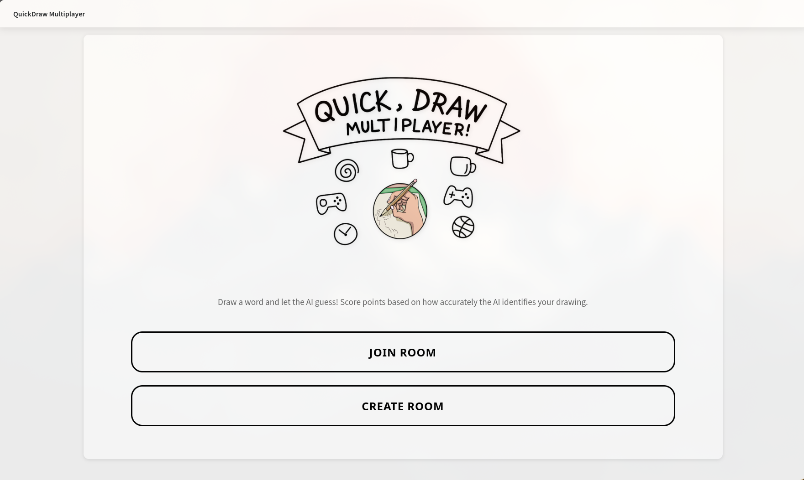
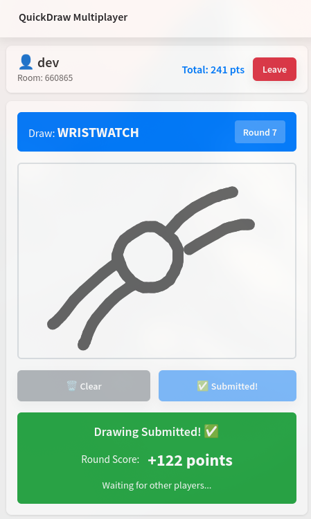
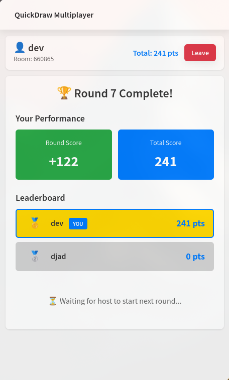

# QuickDraw Multiplayer : AI-Powered Multiplayer Drawing Game

A real time multiplayer drawing game where players compete to draw recognizable sketches, and an **AI model judges how good they are**.

> **Live Demo:** [quickdraw-tdr3.onrender.com](https://quickdraw-tdr3.onrender.com/)

---

## How It Works

1. **A word appears on screen** : something like *cat*, *bicycle*, or *house*.
2. **You draw it** as fast and as clearly as you can.
3. **The AI analyzes your drawing** in real time and tries to guess what it is.
4. **The closer the AI's guess matches the target word, the higher your score.**
5. **Compete against other players**: the best artist wins!

The AI never knows what word you were given. It judges purely from your strokes.

---

## The AI Behind It

The game uses a CNN model with Squeeze-and-Excitation blocks trained on Google's [Quick, Draw! dataset](https://quickdraw.withgoogle.com/data), covering **345 categories** of hand drawn doodles.
---

## how to play: 

- A **host** creates a room and gets a unique room code.
- **Players** join with the code and compete in rounds.
- Each round, everyone draws the same word.
- The AI scores each drawing independently.
- A **live leaderboard** tracks scores across rounds.

---

## Screenshots

<!-- Replace these placeholders with actual screenshots -->

### Drawing Phase

### Results

---

## License

MIT

ARIANE DJAD 
